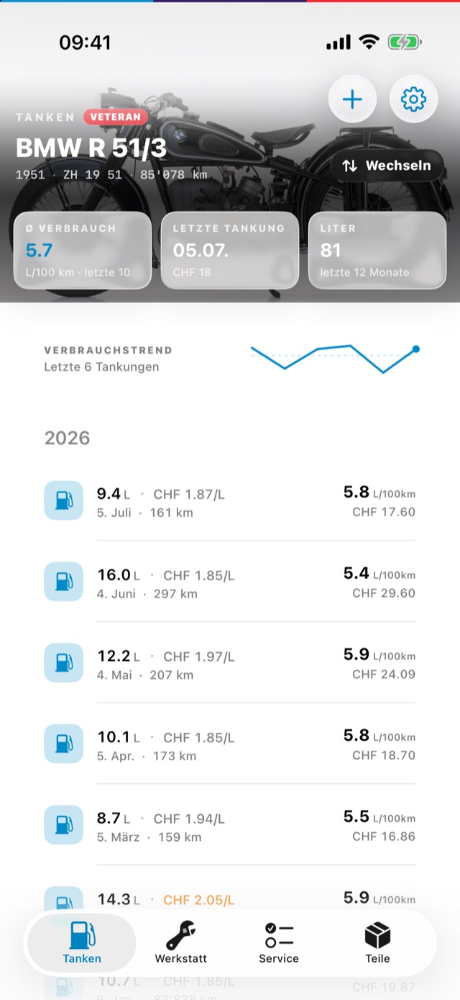
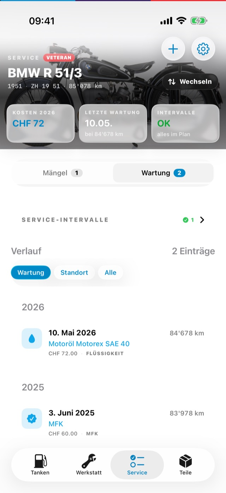

August was the iOS app's month: a new design, shortcuts, offline documents and a long
list of polish. On the web, parts now count towards the cost of your repairs. This post
covers web app **2026.8.0 – 2026.8.3** and iOS app **0.4.0 – 0.9.0**.

## Highlights

### The iOS app in the iOS 26 design

The iOS app now uses the native iOS 26 look — Liquid Glass controls, a layered app icon
and, for the first time, a light mode. Each tab opens with your motorcycle and its key
figures at the top.

### Shortcuts and quick actions

Log a fill-up or scan a part label straight from the Home Screen: press and hold the app
icon for quick actions, or use the new shortcuts in the Shortcuts app and with Siri.

### Documents offline

Pin documents to keep them on your iPhone, with a badge that shows their status. Documents
open in a reader with search inside the document and sharing.

### Parts costs in your repairs

Parts you use in a repair now count towards its cost, and each part shows which repairs
it went into — in the web app and in the iOS app's parts tab.

### Polish everywhere

Bigger tap targets, haptics, clearer empty states and better VoiceOver support. Headers
and fuel rows stay legible at large text sizes, the service history gets compact filter
chips and a search, and the service intervals card gets a collapsed overview.

## Web app

### 2026.8.3 – August 23

- Fix: workshops can be chosen as a motorcycle's location.

[All changes](https://github.com/mightea/MotoManager/compare/2026.8.2...2026.8.3)

### 2026.8.1 – August 21

- Parts count towards the cost of repairs, and each part links back to the repairs it was used in.

[All changes](https://github.com/mightea/MotoManager/compare/2026.8.0...2026.8.1)

### 2026.8.0 – August 7

- Maintenance updates; nothing visible changes.

[All changes](https://github.com/mightea/MotoManager/compare/2026.7.14...2026.8.0)

## iOS app

### 0.9.0 – August 31

- Compact filter chips for the service history and a collapsed overview of the service intervals.
- Fuel fields drop their placeholder once you type the full value again.
- Fix: half-typed fill-ups survive the app being closed in the background.
- Fix: the scan button is back on the parts toolbar.

[All changes](https://github.com/mightea/MotoManager-App/compare/v0.8.0...v0.9.0)

### 0.8.0 – August 24

- Bigger tap targets, haptics, clearer empty states and better VoiceOver support.
- Grouped toolbars, banners that dismiss themselves, currency symbols and a search in the history.
- Fix: model years display correctly and the fuel-station spinner no longer runs forever.
- Fix: the history filter no longer gets stuck on *Alle*.
- Fix: headers and fuel rows stay legible at large text sizes.

[All changes](https://github.com/mightea/MotoManager-App/compare/v0.7.0...v0.8.0)

### 0.7.0 – August 23

- Storage locations can be linked to workshops.
- Faster app and smoother everyday workflows.
- A new image on the login screen.

[All changes](https://github.com/mightea/MotoManager-App/compare/v0.6.0...v0.7.0)

### 0.6.0 – August 18

- Native iOS 26 design with Liquid Glass, and a light mode.
- Layered app icon and polished swipe actions.
- Shortcuts and Home Screen quick actions for logging fuel and scanning labels.
- Fix: no more flashes when switching between parts segments.

[All changes](https://github.com/mightea/MotoManager-App/compare/v0.5.0...v0.6.0)

### 0.5.0 – August 17

- Parts are filtered to the selected motorcycle by default.
- Empty document segments explain why they are empty.
- Usability improvements across all tabs.
- Fix: fuel stations show at their saved location.
- Fix: logging out clears everything stored on the device.

[All changes](https://github.com/mightea/MotoManager-App/compare/v0.4.0...v0.5.0)

### 0.4.0 – August 16

- Pin documents for offline use, with a status badge.
- Documents open in a reader with search and sharing.
- Parts costs on repairs, and links to the repairs in the parts tab.
- Accessibility improvements.
- Fix: storage locations can be created from the empty parts list.
- Fix: workshop sections and their add buttons stay visible when there is no data yet.

[All changes](https://github.com/mightea/MotoManager-App/compare/v0.3.0...v0.4.0)
