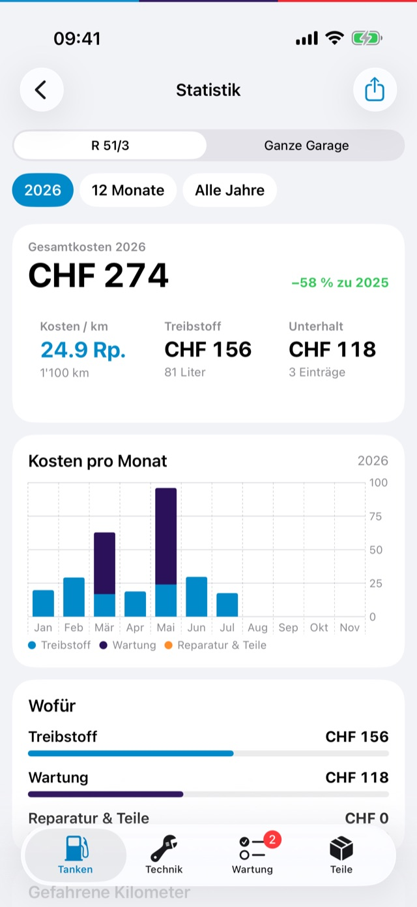
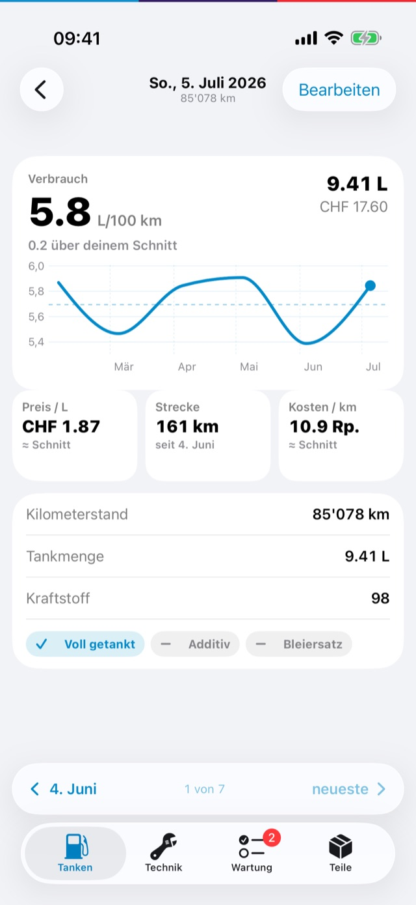
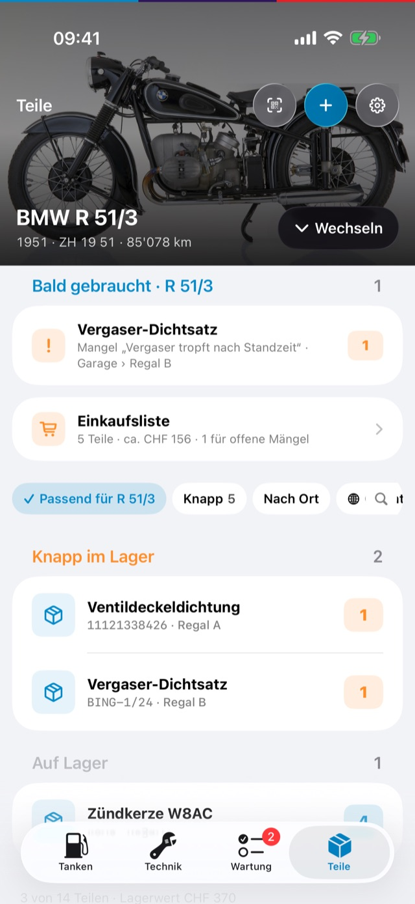
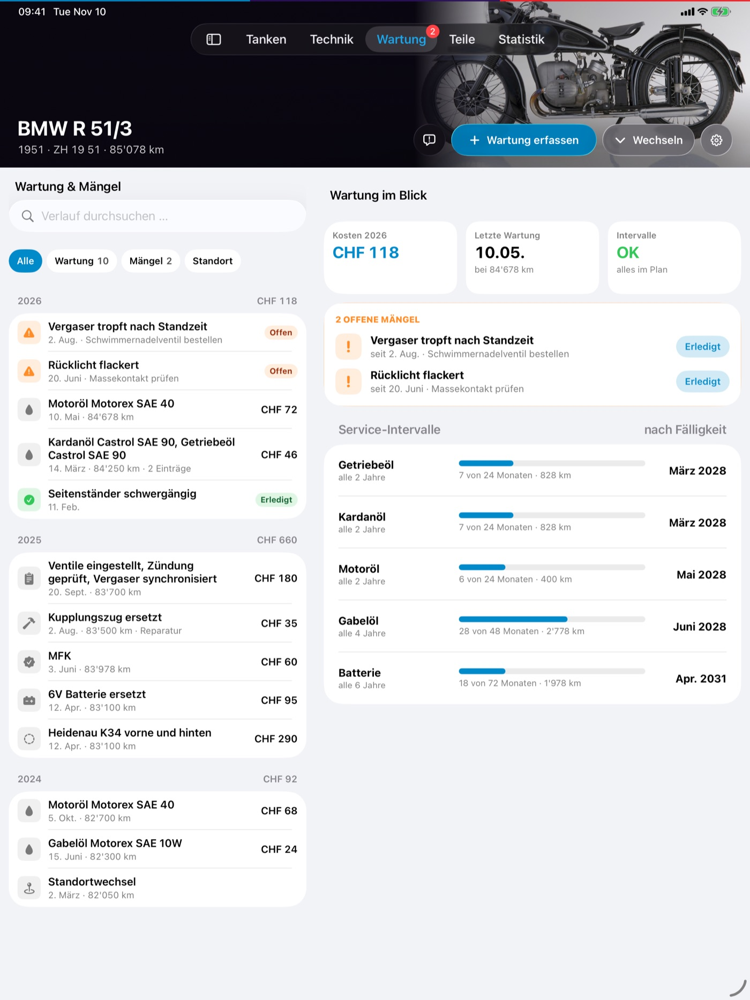

November was a big month for MotoManager. The web app and the iOS app both got a new look,
and most new features landed in both at once. This post covers web app
**2026.11.0 – 2026.11.5** and iOS app **0.17.0 – 0.21.1**.

## Highlights

### Statistics with total cost of ownership

The statistics page was rebuilt from scratch: charts, a cost breakdown and the total cost of
ownership of each motorcycle. You can pick the last 3, 5 or 10 years. On the iPhone, statistics are linked from the *Tanken* and
*Wartung* tabs; on iPad they get their own tab.

### Partial fill-ups

You can now record whether a fill-up actually filled the tank. Consumption is measured from
full tank to full tank, so a quick top-up no longer skews the figures. The fuel detail on
iOS was redesigned around this — consumption first, compared with the fills before and after.

### Replaced odometers

Swapped the instrument cluster? MotoManager now keeps the instrument reading and the total
distance apart, so the mileage stays correct across the replacement. The odometer reading
is also recorded when you sell a motorcycle. (Web app; the iOS app follows in its next
release.)

### Parts and defects, linked

Spare parts can be linked to open defects, and the link shows on both sides — on the web
and in the iOS app. Stock warnings got quieter: a part only counts as low when it was used
in more than three repairs. On iOS, the parts tab now plans ahead with *needed soon*, a
shopping list and scan-to-book.

### Torque values from the model catalog

Import torque values from the model catalog, and share your own values back for other
owners of the same model.

### Document types

Documents now have a type, with a filter in the library and pickers for upload and edit.
The iOS app gains a document reader in the workshop and offline document settings.

### Connect the iPhone app with a QR code

The web app's settings show a QR code and link that open the iOS app with the login
prefilled.

### A new look

Garage, bike pages, parts, storage locations, documents, expenses, statistics, the map,
settings were all realigned with the design proposals. On iOS the iPad,
iPhone and Duo layouts were reworked, the *Wartung* tab became a single filtered timeline,
and the tab bar collapses to the active tab while you scroll.

## Security

Signing in and opening documents are better protected: passkey logins can no longer be
replayed, and documents open without your session appearing in the link.

## Web app

### 2026.11.5 – November 15

- Support replaced odometers with total and instrument readings.

[All changes](https://github.com/mightea/MotoManager/compare/2026.11.4...2026.11.5)

### 2026.11.4 – November 9

- Bike page leads with its key numbers and states each fact once.
- Flag parts as low only when used in more than three repairs.
- Garage shows what is due.
- Import torque values from the model catalog and share your own values there; the catalog shows how many shared values each model has.
- Link parts to open defects.
- Parts table, storage split view and per-bike expense shares.
- Service intervals show their progress.
- Settings get a section index and compact location lists.
- Show and set a type for documents.
- Show when currency rates were last updated.
- Larger labels and text-safe status colours; documents, expenses, stats and map get page titles and summaries; everything realigned with the design proposals.
- Fix: parts in stock bought in a foreign currency are valued with current exchange rates.
- Fix: buttons, numbers and seasons no longer wrap mid-label.

[All changes](https://github.com/mightea/MotoManager/compare/2026.11.3...2026.11.4)

### 2026.11.3 – November 8

- Record whether a fuel fill filled the tank, and show partial fills.
- Show a QR code and link in settings to connect the iPhone app.

[All changes](https://github.com/mightea/MotoManager/compare/2026.11.2...2026.11.3)

### 2026.11.2 – November 7

- Universal links for part and storage-location labels.
- Enter the odometer reading when selling a motorcycle.
- Select the last 3, 5 or 10 years on the stats page.

[All changes](https://github.com/mightea/MotoManager/compare/2026.11.1...2026.11.2)

### 2026.11.1 – November 4

- Rebuilt stats page with charts, cost breakdown and total cost of ownership.
- Fix: fuel records imported from Road Trip use the correct currency rate.

[All changes](https://github.com/mightea/MotoManager/compare/2026.11.0...2026.11.1)

### 2026.11.0 – November 4

- Fix: documents open without your session appearing in the link.

[All changes](https://github.com/mightea/MotoManager/compare/2026.10.2...2026.11.0)

## iOS app

### 0.21.1 – November 11

- Fix: sessions that lost their connection settings in the previous update work again.

[All changes](https://github.com/mightea/MotoManager-App/compare/v0.21.0...v0.21.1)

### 0.21.0 – November 10

- Maintenance updates; nothing visible changes.

[All changes](https://github.com/mightea/MotoManager-App/compare/v0.20.0...v0.21.0)

### 0.20.0 – November 9

- Document types with a library filter and upload/edit pickers.
- Part–defect links sync across your devices and show on parts and defects.
- Only parts used in more than three repairs count as low in stock.
- The shopping list is informational instead of booking stock; hand-added entries disappear once their stock rises.

[All changes](https://github.com/mightea/MotoManager-App/compare/v0.19.0...v0.20.0)

### 0.19.0 – November 8

- Save and sync whether a fill-up filled the tank.
- Redesigned fuel detail — consumption first, compared, with neighbours; a smoother consumption curve.
- Statistics: linked from *Tanken* and *Wartung* on iPhone, a fifth tab on iPad and Duo.
- Plan parts: needed soon, shopping list, scan to book.
- Open a connect link from the web app to prefill the login.
- The tab bar collapses to the active tab while scrolling.

[All changes](https://github.com/mightea/MotoManager-App/compare/v0.18.0...v0.19.0)

### 0.18.0 – November 8

- Document reader for the workshop and offline document settings.
- Fix: header buttons stay in the same position on every tab.
- Fix: the iPad layout fits smaller iPads; interval bars come to the iPhone.

[All changes](https://github.com/mightea/MotoManager-App/compare/v0.17.0...v0.18.0)

### 0.17.0 – November 7

- Edit the motorcycle, open labels via universal links, service intervals with reminders, and an issue lifecycle.
- New iPad, iPhone and Duo layouts; redesigned documents and parts tab.
- The *Wartung* tab is one filtered timeline.
- The focused fuel field stays above the keyboard.
- Login shows its progress and clears errors without layout jumps.
- Fix: the way back to the overview sits in the detail's own bar.
- Fix: trim whitespace around the username before logging in.

[All changes](https://github.com/mightea/MotoManager-App/compare/v0.16.0...v0.17.0)
